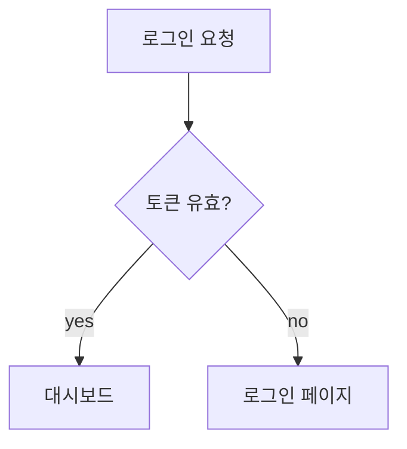

# Status Dashboard (HTML 뷰 + JSON 데이터)

## Overview

작업자(사람)가 **최종 결과만 보기 좋게** 확인하고, **AI가 데이터를 작성·수정**하는 추적 문서를 만든다. 핵심 원칙:

> **데이터와 표현을 분리한다.** JSON = AI가 매번 고치는 데이터. HTML = 한 번 만들고 거의 안 고치는 렌더러(뷰).

사람은 HTML만 본다. AI는 JSON만 손댄다. 둘은 **JSON 스키마(계약)** 로만 연결된다. 스키마만 지키면 두 파일은 영원히 따로 굴러간다. 최종 목표는 **작업자가 한눈에 이해하기 쉽게** 만드는 것.

## When to Use

- 이슈/할일/진행상황/상태/로드맵을 보기 좋은 문서로 관리해 달라고 할 때
- 혼자(또는 소수) + AI가 코드 실제 상태 기반으로 트래킹을 맡는 경우
- GitHub Issues의 협업 기능이 필요 없는 단독 프로젝트

**When NOT to use:** 여러 명이 실시간 협업 → GitHub Issues/Projects가 맞다. 단순 메모 한 장 → 그냥 Markdown.

## 왜 이 구조인가 (의사결정 요약)

| 가정 | 최적 포맷 | 이유 |
|------|-----------|------|
| 사람이 편집도 하고 봄 | MD + YAML frontmatter | diff·수기편집 친화 |
| AI가 편집, 사람은 **안 봄** | 순수 JSON | 표현 불필요, 가장 견고 |
| **AI가 편집, 사람은 결과만 봄** | **JSON 데이터 + HTML 뷰어** | 표현은 HTML의 본업, 데이터는 견고하게 분리 |

AI 전용 편집이면 편집 취약성·git diff·grep 논거는 무의미해진다. 남는 기준은 단 하나 — "사람이 결과를 보느냐". 보면 HTML이 정답이고, 데이터는 JSON으로 빼는 게 가장 깔끔하다.

## Architecture (한 폴더에 모은다)

```
<target>/                 # 예: docs/issue/  또는  docs/status/
  index.html              # 뷰어 (단 1개, 거의 동결)
  data.json               # 데이터 (1개)  ── 또는 ──
  manifest.json           # 여러 데이터로 나눌 때 소스 목록
  issues.json             # 분할 데이터 (다수 가능)
  milestones.json
  flows/                  # (선택) 흐름 설명 Markdown + Mermaid
    architecture.md
```

- **HTML은 1개.** 무슨 데이터가 들어와도 그려주는 빈 틀. 디자인 바꿀 때만 손댐(거의 없음).
- **테마:** 라이트 모드 기본, 헤더 버튼으로 다크 토글(선택값 localStorage 저장, Mermaid 테마도 연동). 색감은 `index.html`의 `:root`(라이트) / `[data-theme="dark"]`(다크) 변수에서 조정.
- **JSON은 1개 또는 다수.** 양이 커지면 `manifest.json`으로 쪼갠다.
- **흐름이 필요하면 Markdown + Mermaid.** 뷰어가 fetch해서 다이어그램으로 렌더.

## 데이터 계약 (JSON 스키마)

이게 이 스킬의 핵심. AI는 항상 이 형태로만 데이터를 채운다. 전체 예시는 `template/data.example.json` 참고. 요약:

```json
{
  "project": "프로젝트명",
  "updated": "2026-06-17",
  "statuses": [
    { "key": "todo", "label": "할 일", "color": "#94a3b8" },
    { "key": "in-progress", "label": "진행중", "color": "#3b82f6" },
    { "key": "done", "label": "완료", "color": "#22c55e" },
    { "key": "blocked", "label": "막힘", "color": "#ef4444" }
  ],
  "issues": [
    {
      "id": 1,
      "title": "로그인 실패 안내 모달",
      "status": "done",
      "priority": "high",
      "tags": ["ui"],
      "created": "2026-06-17",
      "updated": "2026-06-17",
      "verify": "LoginErrorModal.tsx 존재 + 계정 잠김 분기",
      "tasks": [
        { "text": "모달 레이아웃", "done": true },
        { "text": "계정 잠김 안내", "done": true }
      ],
      "note": "선택 설명",
      "links": [{ "label": "commit", "url": "..." }]
    }
  ],
  "flows": ["flows/architecture.md"]
}
```

**필드 규칙**
- `status` 값은 `statuses[].key` 중 하나여야 한다.
- `priority`: `high | medium | low`.
- `verify` (중요): "AI가 코드에서 실제 상태를 확인할 수 있는 구체적 조건". 이게 있어야 AI가 코드 기반으로 상태를 갱신한다.
- 진행률 = `tasks` 중 done 비율. `tasks`가 없으면 status로 추정(done=100%, in-progress=50%, 그 외 0%).

## 만드는 절차

1. **대상 폴더 결정** — 사용자가 안 주면 `docs/status/` 제안.
2. **뷰어 복사** — `template/index.html`을 대상 폴더에 그대로 복사. (수정 거의 불필요)
3. **데이터 채우기** — `template/data.example.json` 스키마로 `data.json` 작성. 이슈가 많으면 `manifest.json` + 분할.
4. **흐름이 필요하면** — `flows/*.md`에 Mermaid 작성하고 `flows` 배열에 등록.
5. **여는 법 안내** — 아래 CORS 항목 참고.

## ⚠️ file:// CORS — 반드시 안내할 것

HTML을 그냥 더블클릭하면 옆의 `*.json`/`*.md`를 `fetch()` 못 한다(브라우저가 `file://` 차단). 분리 구조의 유일한 실질 함정. 해결:

1. **로컬 서버 한 줄(추천):** 대상 폴더에서 `python3 -m http.server` 후 표시된 주소 접속.
2. **VS Code:** Live Server / Live Preview 확장으로 `index.html` 열기.
3. **더블클릭만 고집하면:** 데이터를 `<script>`로 인라인해야 함 → 분리의 이점이 사라지므로 비권장.

`template/index.html`은 fetch 실패 시 이 안내 문구를 화면에 띄우도록 되어 있다.

## 흐름은 Markdown + Mermaid로

복잡한 절차/아키텍처는 표 대신 다이어그램이 이해가 빠르다. `flows/*.md`에 작성:

````markdown
# 인증 흐름


````

뷰어가 Mermaid CDN으로 렌더한다(인터넷 필요). 오프라인이면 mermaid 번들을 폴더에 두고 스크립트 경로만 교체.

## 유지보수 워크플로우 (AI의 반복 작업)

요청이 오면 **데이터만** 만진다(HTML은 안 건드림):
1. 코드/커밋 실제 상태 확인 (특히 각 이슈의 `verify` 조건).
2. 해당 이슈의 `status`/`tasks[].done`/`updated` 갱신, 새 이슈는 `issues`에 추가.
3. 최상위 `updated` 날짜 갱신.
4. 데이터가 커지면 `manifest.json`으로 분할.

## Common Mistakes

| 실수 | 바로잡기 |
|------|----------|
| 이슈 내용을 HTML 태그 안에 직접 작성 | 데이터는 JSON, HTML은 렌더러로만 |
| 데이터 바꿀 때마다 HTML도 수정 | HTML은 한 번 만들고 동결. 데이터만 바뀜 |
| 더블클릭으로 열려다 빈 화면 | file:// CORS — 로컬 서버로 서빙 |
| `status`에 `statuses`에 없는 값 사용 | 계약 위반. enum 안에서만 |
| `verify` 생략 | AI가 코드 기반 상태 판단 불가. 항상 구체적으로 |
| 데이터를 JSON에 다 넣고 흐름까지 글로 설명 | 흐름은 Mermaid로, 보는 사람 이해가 최우선 |
